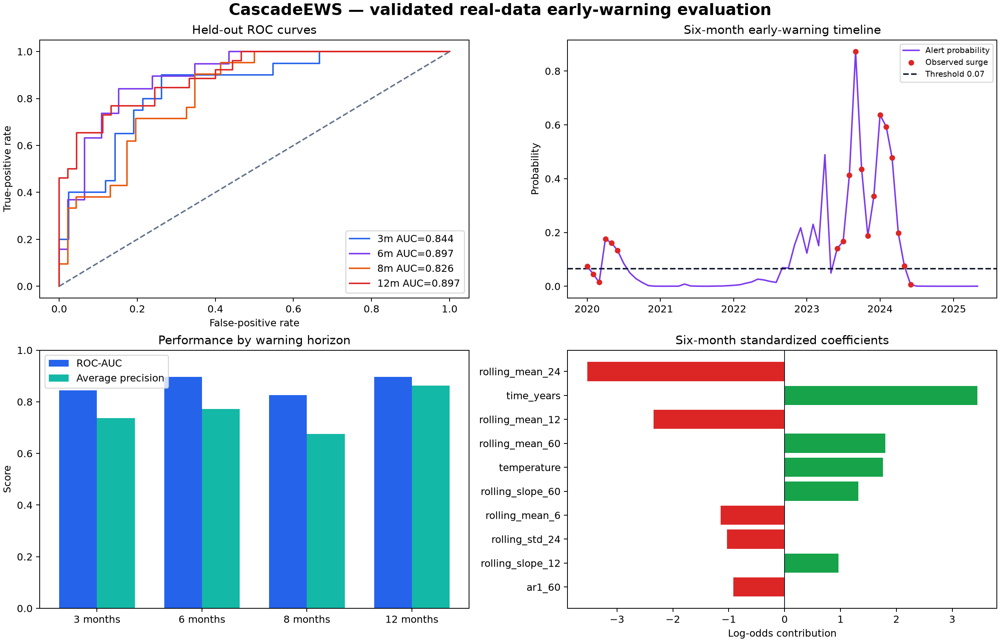
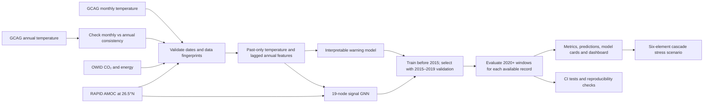

# CascadeEWS

### Real-data climate signals, interpretable warnings, and a graph learning research track

[](https://github.com/haarikaalla/CascadeEWS/actions/workflows/ci.yml)
[](https://www.python.org/)
[](LICENSE)

CascadeEWS is an end-to-end climate machine-learning project that asks a precise,
testable question:

> From information available at the forecast date, will the mean global temperature
> anomaly over the next 3, 6, 8, or 12 months be at least **0.10 °C above** the preceding
> 12-month mean?

The project combines a validated, interpretable temperature warning model with a
PyTorch graph neural network trained on temperature, CO₂, energy, and observed RAPID
AMOC signals. A separate scenario engine explores how assumed stress can spread among
six climate elements over 52 weeks. The interactive dashboard shows all three paths,
their results, and their limitations. This is a research demonstration, not an
operational disaster warning system.

| Project path | What it produces | Evidence |
|---|---|---|
| Temperature warning model | Risk of a defined global temperature surge 3, 6, 8, or 12 months ahead | Chronological 2020+ evaluation, block-bootstrap intervals and committed predictions |
| Real-data signal GNN | Risk of the same surge target with an observed AMOC input | Chronological evaluation on the shorter 2004–2022 RAPID record; results vary substantially by horizon |
| Cascade scenario | Assumption-driven stages for six connected climate elements over 0–52 weeks | Reproducible stress-test simulation; stage times are scenario outputs |



## Validated results

All values below come from the chronologically held-out **2020+ evaluation period**. Model family,
regularization, and alert threshold were chosen using pre-2020 data only.

| Horizon | Selected signal set | ROC-AUC | 95% block-bootstrap CI | Average precision | F1 | Precision | Recall |
|---:|---|---:|---:|---:|---:|---:|---:|
| 3 months | seasonal | **0.844** | 0.676–0.963 | 0.737 | 0.696 | 0.615 | 0.800 |
| 6 months | temperature history | **0.897** | 0.793–0.976 | 0.771 | **0.727** | 0.640 | **0.842** |
| 8 months | temperature history | **0.826** | 0.632–0.966 | 0.676 | 0.091 | 1.000 | 0.048 |
| 12 months | temperature history | **0.897** | 0.762–0.991 | **0.862** | 0.207 | 1.000 | 0.115 |

The 6-month horizon is the primary operating point because it offers the best balanced
threshold. The balanced 8- and 12-month thresholds are conservative and miss many
events. For warning-oriented use, the project also reports a second threshold chosen
to require at least 90% recall on validation data:

| Long horizon | High-sensitivity precision | High-sensitivity recall | High-sensitivity F1 |
|---:|---:|---:|---:|
| 8 months | 0.579 | 0.524 | 0.550 |
| 12 months | **0.895** | **0.654** | **0.756** |

This is an explicit operating-point tradeoff, not a different model or a guarantee of
detecting a climate cascade. Full results are in
[`results/validated/metrics.json`](results/validated/metrics.json), with responsible
use documented in the [`model card`](results/validated/MODEL_CARD.md).

## Real-data graph neural network

CascadeEWS now trains a genuine PyTorch GNN over **19 observed signal nodes** from five
committed real-world datasets. The graph includes temperature history and variability,
CO₂, greenhouse contribution, primary energy, renewable and fossil shares, seasonality,
time and the official RAPID 26.5°N 12-month mean AMOC-strength observation.

| Horizon | GNN ROC-AUC | GNN average precision | Balanced F1 | Evaluation windows |
|---:|---:|---:|---:|---:|
| 3 months | 0.466 | 0.173 | 0.000 | 35 |
| 6 months | 0.245 | 0.121 | 0.125 | 38 |
| 8 months | **0.840** | **0.457** | 0.000 | 40 |
| 12 months | 0.541 | 0.245 | 0.000 | 44 |

The 8-month GNN ranks outcomes better than its other horizons, but its balanced alert
threshold produced no positive alerts in the evaluation period. The AMOC record begins
in 2004 and the committed snapshot ends in 2022, leaving only 35–44 evaluated windows.
The GNN and baseline figures above cover different windows, so they are not a controlled
head-to-head performance comparison. Full details are in the
[`GNN model card`](results/gnn/MODEL_CARD.md).

The GNN target remains the defined global temperature surge. AMOC is a real contextual
input node—it is **not** an AMOC-collapse target, and node attention is not causal
evidence.

## Multi-element cascade scenario

The application also includes a transparent **scenario-analysis layer** for six
connected climate elements:

- AMOC
- Greenland ice sheet
- Arctic sea ice
- Amazon rainforest
- ENSO
- West Antarctic ice sheet

It propagates a selected normalized stress level across an explicit directed coupling
matrix for 0–52 weeks and assigns four stages: **Stable** (`<0.25`), **Watch**
(`0.25–0.49`), **Warning** (`0.50–0.74`) and **Critical** (`≥0.75`). The dashboard can
use either an analyst-selected stress value or the latest probability from the chosen
validated warning horizon.

This layer is a reproducible stress test—not a fitted physical Earth-system model. For
example, “AMOC reaches Warning at scenario week 11” under the committed `0.60` stress
scenario means only that the declared assumptions crossed the declared threshold. It
does **not** mean an AMOC collapse is forecast 11 weeks away. Assumptions and coupling
strengths are visible in [`cascadeews/cascade.py`](cascadeews/cascade.py), with committed
outputs in [`results/scenario`](results/scenario).

## System architecture



### Leakage controls

- Rolling means, deviations, trends, and AR(1) estimates use observations strictly
  before the forecast origin.
- CO₂ and energy fields are lagged by 12 months to reflect annual reporting delay.
- Samples are split by the **end of the forecast window**, so targets cannot cross a
  temporal boundary.
- Candidate features and regularization are selected only on validation ROC-AUC.
- Balanced alerts maximize validation F1. High-sensitivity alerts maximize validation
  precision subject to at least 90% validation recall; test labels tune neither mode.

## Data and its role

| Dataset in this repository | Role | How it is used |
|---|---|---|
| `berkeley_monthly.csv` | Primary signal and target | The file's **GCAG** monthly global temperature-anomaly series; the inherited filename is retained for compatibility. |
| `berkeley_annual.csv` | Independent quality check | Reconciles annual values against monthly aggregation across 45 experiment years (correlation >0.999; maximum difference <0.001 °C). |
| `owid_co2.csv` | Candidate contextual signals | World CO₂, growth, and GHG temperature contribution, shifted by 12 months. |
| `owid_energy.csv` | Candidate contextual signals | World primary energy, renewable share, and fossil share, shifted by 12 months. |
| `amoc_rapid_12_month_mean.csv` | Real GNN context | RAPID 26.5°N observed 12-month mean AMOC strength in Sverdrups, used only by the GNN. |

The pipeline compares seasonal-only, temperature-history, and full contextual feature
sets. A larger feature set is not assumed to be better: validation rejected the OWID
drivers for all four current horizons. This is useful negative evidence and prevents
unsupported claims. Exact file sizes, row counts, and SHA-256 hashes are written into
every result file. See the [`data card`](docs/DATA_CARD.md) for provenance and caveats.

## Run the complete project

```bash
git clone https://github.com/haarikaalla/CascadeEWS.git
cd CascadeEWS
python -m venv .venv
source .venv/bin/activate          # Windows: .venv\Scripts\activate
python -m pip install --upgrade pip
pip install -e ".[dev,dashboard,research]"

cascadeews verify-data
cascadeews train
cascadeews train-gnn
cascadeews simulate-cascade --pressure 0.60 --weeks 52
pytest
streamlit run app.py
```

The dashboard opens with committed results even before retraining. It contains six tabs:
Overview, Warning timeline, Model comparison, Real-data GNN, Cascade scenario, and
Data & governance. Choose a horizon and balanced or high-sensitivity alert mode to
inspect the corresponding historical results. Training regenerates the committed
outputs and writes model binaries locally under `artifacts/`.

For a lighter install that skips PyTorch and GNN retraining, use
`pip install -e ".[dev,dashboard]"` and omit `cascadeews train-gnn`. The committed GNN
results still appear in the dashboard.

### Command-line interface

```bash
cascadeews --help
cascadeews verify-data             # validate inputs and print fingerprints
cascadeews train                   # rebuild models, metrics, figure and model card
cascadeews train-gnn               # train the real-data PyTorch signal GNN
cascadeews simulate-cascade --pressure 0.60 --weeks 52
python run.py                       # compatible one-command training wrapper
```

Generated model binaries are kept under `artifacts/` and ignored by Git. Validated
metrics, predictions, evaluation image, and model card are committed so results can be
audited without trusting a prebuilt binary.

## Repository map

```text
cascadeews/
  data.py          input validation, provenance, past-only feature engineering
  training.py      validation search, thresholding, evaluation and uncertainty
  cascade.py       six-element, 0–52-week transparent cascade stress test
  gnn.py           observed-signal graph, message passing, attention and evaluation
  pipeline.py      deterministic end-to-end experiment orchestration
  reporting.py     publication-ready figure and model card
  dashboard.py     interactive result exploration
tests/              unit and end-to-end reproducibility tests
results/validated/  auditable metrics, predictions, figure and model card
results/scenario/   illustrative stage timeline, summary and visualization
results/gnn/        real-data GNN metrics, predictions and model card
data/raw/           pinned source-data snapshots
docs/DATA_CARD.md   data provenance, intended use and limitations
.github/workflows/  multi-version tests, packaging and reproduction checks
```

## Engineering quality

- Installable package with modular boundaries and CLI entry points.
- Unit and pipeline tests with more than 85% required coverage.
- CI on Python 3.10–3.13, wheel smoke test, and committed-result reproduction check.
- A dedicated CI job trains and checks the PyTorch GNN against the committed datasets.
- Weekly grouped Dependabot updates for Python and GitHub Actions dependencies.
- Deterministic seeds and temporal block bootstrap for autocorrelated data.
- Model card, immutable data fingerprints, and explicit limitations.

## Scope and limitations

- This model detects a defined **global warming-surge event**; it does not demonstrate
  prediction of AMOC collapse, ice-sheet failure, or local climate tipping points.
- The test set contains 62–71 monthly windows. Confidence intervals are more
  informative than a single headline score.
- Monthly windows overlap and are autocorrelated. Block bootstrap helps, but
  independent future validation is still required.
- Logistic coefficients describe associations after scaling; they are not causal.
- Historical notebooks, graph models, cascade-index experiments, synthetic data, and
  legacy figures remain an **experimental research track**. They are not part of the
  validated headline results until assessed under the same locked protocol.
- The GNN contains direct RAPID AMOC-strength observations, but the repository has no
  verified AMOC-collapse labels. Scenario elements remain conceptual stress-test nodes.

## What the upgrade changed

| Before | Now |
|---|---|
| Headline metrics were not tied to a reproducible real-data evaluation | Every headline value is regenerated from committed datasets and predictions |
| Synthetic graph experiments and real-data claims were mixed | Validated path and legacy research track are explicitly separated |
| No locked chronological test protocol | Split boundaries follow complete target windows |
| No uncertainty interval | 500-sample, 12-month block-bootstrap ROC-AUC interval |
| Monolithic scripts | Package, CLI, dashboard, model card, tests and CI |
| Manual dependency maintenance | Weekly Dependabot checks for Python and Actions |

## Responsible next steps

Useful extensions include spatial reanalysis data, pre-registered event definitions,
geographically blocked validation, established early-warning baselines, probability
calibration, and an independently maintained future holdout. They are deliberately
described as future work rather than presented as completed evidence.

## License

Code is released under the [MIT License](LICENSE). Source datasets retain their own
terms; consult the upstream sources in the data card before redistribution or
production use.
